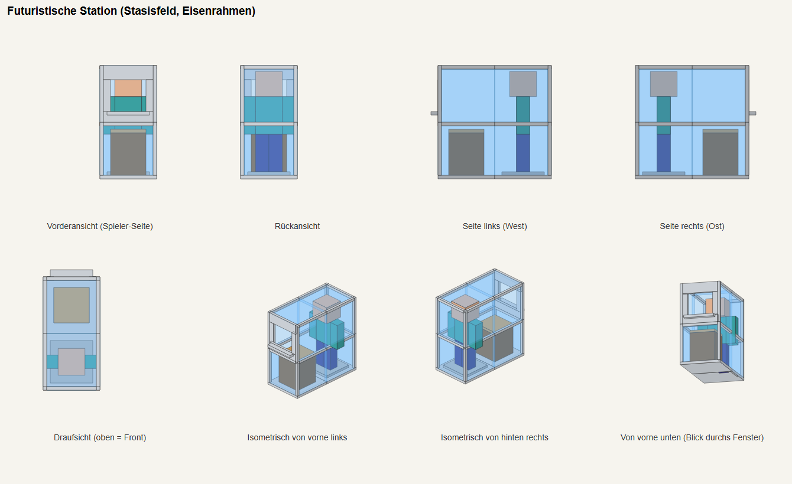
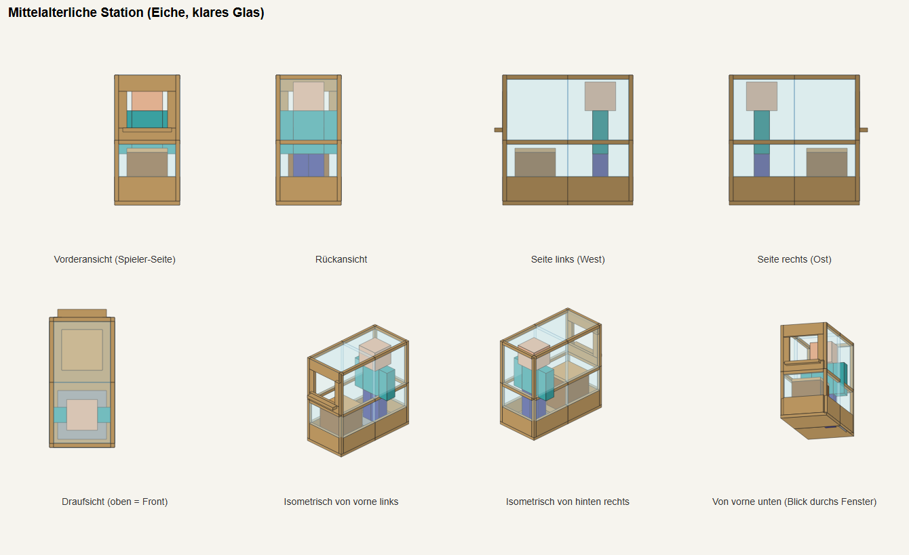

# Easy Trading Station

[](https://github.com/dr460neye/easy_trading_station/actions/workflows/build.yml)

A NeoForge addon for [Easy NPC](https://modrinth.com/mod/easy-npc). Catch an Easy NPC with the
**NPC Catcher** and keep it in a glass **Trading Station**. The NPC keeps its trades, dialogs
and scripts, but stands still in the station and costs (almost) no performance, which makes it a
clean alternative to a pile of walking villagers.

> **Status:** feature complete, being tested in game. Built for **Minecraft 26.1.2** and
> **NeoForge 26.1.2.126**, requires **Easy NPC 7.18.0+**.

<p align="center">
  
  
</p>

*(Technical sketches generated from the models; in-game screenshots will follow.)*

## Features

- **NPC Catcher**: capture (the NPC is removed) or clone an Easy NPC. Configurable globally and
  per NPC type: `CAPTURE`, `CLONE`, `BOTH`, `DISABLED`.
- **Trading Station**: a 1 wide × 2 deep × 2 high glass booth with an NPC podium, an access
  window and a workstation in front. The whole booth is one placeable block.
- **No ticking NPC.** The station only stores the NPC's data. The client renders a cached,
  never-ticking display copy; the server creates a paused NPC only while a player is talking or
  trading and stores its state again afterwards.
- **Everything keeps working**: shops, dialogs, actions on interaction and click handlers of other
  mods (e.g. KubeJS) see a normal right-click.
- **Workstations per NPC.** Each NPC needs its workstation in the station, configurable per NPC
  type or name (*the Wayfarer needs a Waystone, the Beastmaster a Bestiary Lectern*). Without it
  the NPC puts up a strike sign and nothing of its logic runs.
- **Many looks**: futuristic stasis-field station, stone and every wood type. Wood types from
  other mods get their own station automatically.
- **Safe for scripted NPCs**: destroying the catcher of a captured NPC makes the NPC *die at its
  home position* (normal death events), so respawn logic in modpacks keeps working. Stations are
  explosion-proof.

## How to use

| Action | Result |
|--------|--------|
| Craft the **NPC Catcher** (3 string + 2 sticks) | Net to catch NPCs |
| Right-click an Easy NPC with the empty catcher | Capture (or clone, see config) |
| Right-click a block with the filled catcher | Release the NPC; the catcher is used up |
| Craft and place a **Trading Station** | 1 × 2 × 2 glass booth, faces you |
| Right-click the station with the filled catcher | Put the NPC in (catcher is used up) |
| **Shift + right-click** the station | Menu with a catcher slot and a workstation slot |
| Right-click the station | Talk/trade with the NPC (needs its workstation) |

In the station menu you can store the NPC and the workstation in any order, so an NPC can be
parked before its workstation is available. Taking the NPC out gives a filled catcher back.

## Configuration

How to decide which NPC needs which workstation, catcher modes, extra variants and shipping the
configs with a modpack: **[docs/CONFIGURATION.md](docs/CONFIGURATION.md)**.

Short version, in the server config:

```toml
[station]
  requiredWorkstations = [
    "wayfarer=waystones:*waystone;Waystone",
    "beastmaster=iceandfire:lectern;Bestiary Lectern"
  ]
```

## Building

Requires **JDK 25**.

```powershell
$env:JAVA_HOME = "<path to JDK 25>"
.\gradlew.bat build        # Windows
./gradlew build            # Linux / macOS
```

The jar is written to `build/libs/` as `easy-trading-station-neoforge-<minecraft>-<version>.jar`.
`./gradlew test` runs the unit tests, `./gradlew runClient` starts a development client.
How to set up, test in the game and send changes: **[CONTRIBUTING.md](CONTRIBUTING.md)**.
Versioning, releases (GitHub + CurseForge) and support for other Minecraft versions:
**[docs/RELEASING.md](docs/RELEASING.md)**.

## Project layout

| Path | Content |
|------|---------|
| `src/main/java/de/dragoni/tradingstation/` | mod code (`item`, `station`, `client`, `config`, `event`, `registry`) |
| `src/main/resources/` | models, blockstates, loot, recipes, lang (generated by `tools/generate_station_assets.py`) |
| `src/test/java/` | unit tests for the pure logic |
| `docs/` | configuration guide, releasing, roadmap, milestones, implementation notes |
| `.github/` | CI (build, test) and release workflows |
| `curseforge/` | CurseForge project page texts and release material |
| `CLAUDE.md`, `.claude/` | notes and skills for AI assisted development |

## Compatibility notes

- Mod id is `easy_npc_trading_station` (kept so ids, configs and worlds stay stable); the display
  name is *Easy Trading Station*.
- Only Easy NPC entities can be caught for now. Support for other mobs is planned.
- Tested with the FTB Evolution 2 modpack (single player); multiplayer and big servers are not
  tested yet.

## License

[MIT](LICENSE). Free to use in modpacks, forks and derived works; keep the copyright notice.
