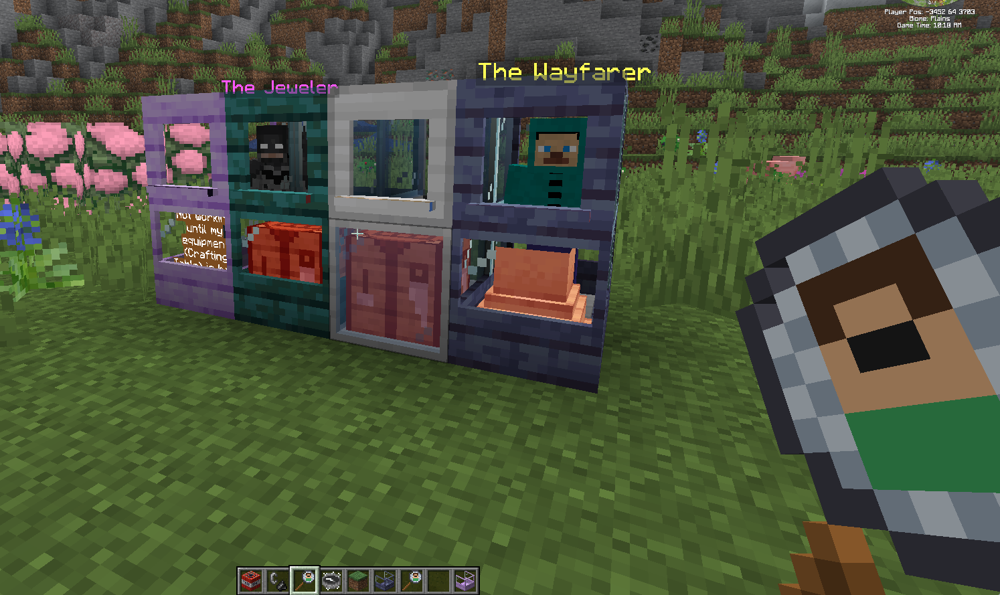
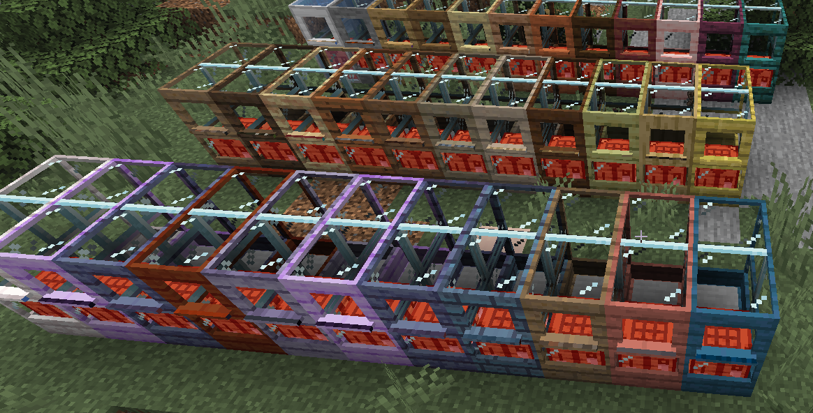

# Easy Trading Station

**Works with vanilla and with [Easy NPC](https://modrinth.com/mod/easy-npc).** Catch a villager, a
wandering trader or (with Easy NPC installed) an Easy NPC with the **NPC Catcher** and keep it in a
glass **Trading Station**: shops, dialogs
and scripts keep working, the NPC stands still and costs (almost) no performance.

*Minecraft 26.1.2 · NeoForge · Easy NPC 7.18.0+ and Easy Villagers are optional*



---

## Why

Villagers and NPCs that walk around, tick and wander off are expensive and annoying in bases. The
Trading Station gives every NPC a place of its own, like a shop booth, without a ticking entity
in your world. Perfect for trading halls and for modpacks with quest or shop NPCs.

## What you get

- **NPC Catcher**: capture or clone Easy NPCs, standard villagers (every profession, also from other
  mods) and wandering traders. The mode is configurable globally, per NPC type and per NPC name.
- **Trading Station**: a 1 × 2 × 2 glass booth with a podium for the NPC, an access window and a
  workstation in front. The upper front frame shows who lives inside: the NPC's name, or the
  profession of a villager. Shift + right-click opens a menu with a slot for the catcher, one for the
  workstation and one for a station upgrade.
- **Villagers too**: a standard villager needs the job site block of its profession, read from the
  game data, so professions of other mods work without any setup. Villagers restock while stored.
  Villagers without a job and nitwits get a sign instead of a head shake.
- **Station upgrades**: Easy NPCs need the *Advanced NPC Trading Station Upgrade*, wandering traders
  the *Wandering Trader Upgrade* (new offers once a day). Standard villagers need none. Right-click a
  station with an upgrade to install it. Recipes and the requirement per NPC are configurable.
- **Everything of the NPC keeps working**: trades, dialogs, actions, click handlers of other mods
  (for example KubeJS shops).
- **Almost no cost**: the station only stores data. The NPC exists in the world only while somebody
  talks to it; the client draws a cached, non-ticking copy.
- **Workstations**: every Easy NPC needs its workstation in the station. Modpack makers decide which
  one per NPC (*the Wayfarer needs a Waystone*). If it is missing, the NPC puts up a strike sign
  and the player gets a hint which workstation is missing.
- **Many styles**: a futuristic stasis-field station, stone, every vanilla wood and automatically
  every wood of other mods (Menril, Rowan, Twilight Forest woods and more).
- **Respects claims**: NPCs in protected areas (FTB Chunks and other protection mods) can not be
  caught by players who may not build there.
- **Safe for scripted NPCs**: if the catcher of a captured Easy NPC is destroyed, the NPC *dies at
  its home position*, so respawn logic of the modpack keeps working. Stations survive explosions.



*Every wood gets its own station, here the ones of FTB Evolution 2.*

## How to use

1. Craft an **NPC Catcher** (3 string, 2 iron ingots, 1 ender pearl) and right-click an NPC or a
   villager. Sneaking decides between capture and clone if the catcher mode is *both*.
2. Craft and place a **Trading Station** (3 glass, emerald, eye of ender, diamond and 3 planks or
   stone; the futuristic one uses 3 iron ingots instead).
3. Right-click the station with the filled catcher, or Shift + right-click for the menu.
4. Put the workstation into the workstation slot (a villager needs the job site block of its
   profession, an Easy NPC the block the pack asks for).
5. Easy NPCs and wandering traders need their upgrade: right-click the station with it.
6. Right-click the station to trade or talk.

## For modpack makers

Everything is a plain config entry or a recipe you can change. The workstation for each Easy NPC:

```toml
[station]
  requiredWorkstations = [
    "wayfarer=waystones:*waystone;Waystone",
    "beastmaster=iceandfire:lectern;Bestiary Lectern"
  ]
```

Match by NPC type or by name, accept item ids, wildcards or tags, add a label for the hint. The
catcher mode can be set per NPC type or name (capture, clone, both, disabled):

```toml
[catcher]
  typeOverrides = ["beastmaster=BOTH", "wayfarer=CAPTURE", "jeweler=CLONE"]
```

Which NPC needs which upgrade, and the recipes of the catcher, the stations and the upgrades, are
config entries as well (`[upgrades]` in the server config, `[recipes]` in the common config).
Full guide:
**[Configuration guide](https://github.com/dr460neye/easy_trading_station/blob/main/docs/CONFIGURATION.md)**

## Good to know

- Easy NPC and Easy Villagers are optional. Without Easy NPC the catcher holds standard villagers
  and wandering traders; with it, Easy NPCs as well. The traders of other mods are planned.
- Standard villagers are never cloned while Easy Villagers is installed.
- Multiplayer and big servers have not been tested yet.
- Needs to be installed on server and client.
- Licensed under MIT. Source code and issue tracker:
  [github.com/dr460neye/easy_trading_station](https://github.com/dr460neye/easy_trading_station)
